<picture>
  <source media="(prefers-color-scheme: dark)" srcset="assets/banner-dark.svg">
  
</picture>

 

I'm **Shaima**, a cybersecurity and AI engineer. I build agents that hunt vulnerabilities, and I red-team LLMs: AI for security, and security for AI. A finding only counts once I've exploited it.

- Incoming vulnerability management engineer at Thales: AI that finds which CVEs are actually exploitable
- Bug bounty hunter on [HackerOne](https://hackerone.com/shm0m?type=user) since August 2026: prompt injection and guardrail bypass
- 2200+ points across 105 challenges on [Root-Me](https://www.root-me.org/klawd-1067490?lang=fr)
- Final year of an MEng in Cybersecurity at ECE Paris
- French, English, Arabic, Spanish

<!-- logos from Simple Icons and Iconify in one violet (#8568db) that reads on both GitHub themes; concepts get symbolic icons -->
| focus |  AI security ·  LLM red teaming ·  alignment ·  evals ·  agentic offensive tooling |
|:---|:---|
| **offensive / red team** |  pentest ·  LLM red teaming ·  reverse engineering ·  adversarial ML ·  Ghidra ·  Metasploit ·  Nmap |
| **data & ai** |  agentic AI ·  MCP ·  RAG ·  LangChain ·  algorithms & data structures |
| **defensive / blue team** |  vulnerability management ·  incident response ·  forensics ·  architecture hardening ·  threat modeling |
| **stack** |  Python ·  Bash ·  C ·  Rust ·  SQL ·  MongoDB ·  GitLab ·  Docker ·  Kubernetes ·  Red Hat |

  <picture>
    <source media="(prefers-color-scheme: dark)" srcset="https://github-profile-summary-cards.vercel.app/api/cards/stats?username=shm0m&theme=github_dark">
    
  </picture>
  <picture>
    <source media="(prefers-color-scheme: dark)" srcset="assets/languages-dark.svg">
    
  </picture>

Where it started

 

Thirty seconds was my all-time record at Subway Surfers. I wanted Prince, the most expensive character in the game, and I was not going to ask for my dad's credit card. So I typed the question every future security person asks one day: *"how to hack subway surfers?"*

A Lucky Patcher tutorial later, my keys and coins shot up and Prince was mine. The win faded fast. The spark did not: I wanted to understand what happens under the interface, and make it my job.

 

[portfolio](https://www.shaimadrh.xyz) · [linkedin](https://linkedin.com/in/shaima-d) · [email](mailto:shaima.derouich@proton.me)

built with intent, not filler.

<!-- reading the source is the right instinct. the flag isn't here, but you're warm: https://www.shaimadrh.xyz -->
