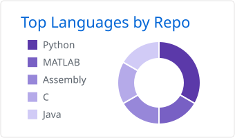

<picture>
  <source media="(prefers-color-scheme: dark)" srcset="assets/banner-dark.svg">
  
</picture>

 

I'm **Shaima**, an application security engineer. I find the flaw nobody modeled, prove it with an exploit, then build tools that keep hunting for it.

I'm in the final year of an MEng in Cybersecurity at ECE Paris, and I speak French, English, Arabic and Spanish.

I've been hunting bugs on [HackerOne](https://hackerone.com/shm0m?type=user) since August 2026. Off the clock, I've scored 2200+ points across 105 challenges on [Root-Me](https://www.root-me.org/klawd-1067490?lang=fr).

<!-- logos from Simple Icons and Iconify in one violet (#8568db) that reads on both GitHub themes; concepts get symbolic icons -->
| focus | AI security · LLM red teaming · alignment · evals · agentic offensive tooling |
|:---|:---|
| **offense** |  Burp Suite ·  Metasploit ·  Nmap ·  Ghidra ·  Kali Linux ·  threat modeling |
| **defense** |  SIEM ·  Wireshark ·  forensics ·  Linux hardening ·  MITRE ATT&CK ·  Dependency-Track ·  SDLC |
| **ai / ml** |  PyTorch ·  TensorFlow ·  scikit-learn ·  LangChain ·  RAG ·  MCP |
| **infra** |  Docker ·  Kubernetes ·  OpenShift ·  Ansible ·  GitLab CI/CD |
| **code** |  Python ·  Rust ·  C ·  Bash ·  TypeScript ·  Node.js ·  React ·  SQL |

  <picture>
    <source media="(prefers-color-scheme: dark)" srcset="https://github-profile-summary-cards.vercel.app/api/cards/stats?username=shm0m&theme=github_dark">
    
  </picture>
  <picture>
    <source media="(prefers-color-scheme: dark)" srcset="assets/languages-dark.svg">
    
  </picture>

Where it started

 

Thirty seconds was my all-time record at Subway Surfers. I wanted Prince, the most expensive character in the game, and I was not going to ask for my dad's credit card. So I typed the question every future security person asks one day: *"how to hack subway surfers?"*

A Lucky Patcher tutorial later, my keys and coins shot up and Prince was mine. The win faded fast. The spark did not: I wanted to understand what happens under the interface, and make it my job.

 

[portfolio](https://www.shaimadrh.xyz) · [linkedin](https://linkedin.com/in/shaima-d) · [email](mailto:shaima.derouich@proton.me)

built with intent, not filler.

<!-- reading the source is the right instinct. the flag isn't here, but you're warm: https://www.shaimadrh.xyz -->
