<picture>
  <source media="(prefers-color-scheme: dark)" srcset="assets/banner-dark.svg">
  
</picture>

<p align="center">
  <a href="https://shaima-drh.vercel.app"></a>
  <a href="https://linkedin.com/in/shaima-d"></a>
  <a href="https://www.root-me.org/klawd-1067490?lang=fr"></a>
  <a href="https://tryhackme.com/p/kl4wd"></a>
</p>

<br>

```yaml
$ whoami
name:     Shaïma Derouich
role:     application security engineer
focus:    [ai security, llm red teaming, agentic offensive tooling]
mindset:  red by instinct, blue by discipline
school:   ECE Paris · MEng Cybersecurity, international section (2022 → 2027)
based:    Paris, FR · open to relocation
speaks:   [french, english, arabic, spanish]
```

<details>
<summary><b>where it started</b> · a Subway Surfers cheat and one very expensive character</summary>
<br>

Thirty seconds was my all-time record at Subway Surfers. I wanted Prince, the most expensive character in the game, and I was not going to ask for my dad's credit card. So I typed the question every future security person asks one day: *"how to hack subway surfers?"*

A Lucky Patcher tutorial later, my keys and coins shot up and Prince was mine. The win faded fast. The spark did not: I wanted to understand what happens under the interface, and make it my job.

There is a flag hidden somewhere in my portfolio, if you like that kind of thing.

</details>

<br>

<picture>
  <source media="(prefers-color-scheme: dark)" srcset="assets/method-dark.svg">
  
</picture>

<br>

<picture>
  <source media="(prefers-color-scheme: dark)" srcset="assets/arsenal-dark.svg">
  
</picture>

<br>

<picture>
  <source media="(prefers-color-scheme: dark)" srcset="assets/proof-dark.svg">
  
</picture>

<p align="center"><sub>AWS Certified Cloud Practitioner · CompTIA CySA+ · TryHackMe Security Engineer · ANSSI SecNumAcadémie</sub></p>

<br>

<picture>
  <source media="(prefers-color-scheme: dark)" srcset="https://raw.githubusercontent.com/shm0m/shm0m/output/snake-dark.svg">
  
</picture>

<br>

<a href="mailto:shaima.derouich@proton.me">
  <picture>
    <source media="(prefers-color-scheme: dark)" srcset="assets/footer-dark.svg">
    
  </picture>
</a>

<!-- reading the source is the right instinct. the flag isn't here, but you're warm: https://shaima-drh.vercel.app -->
